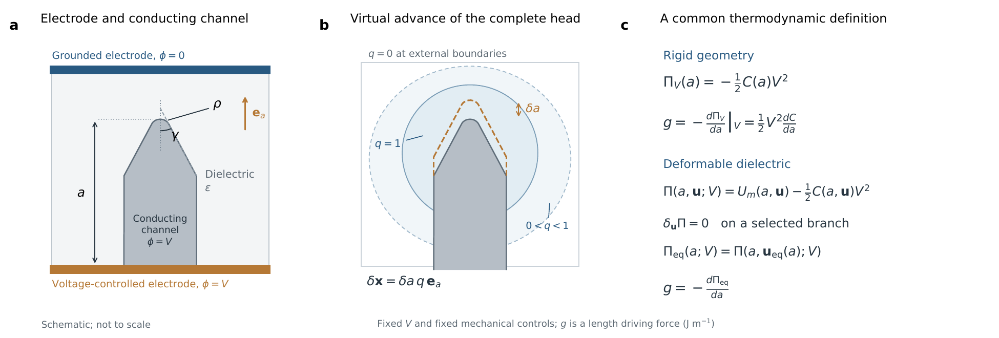
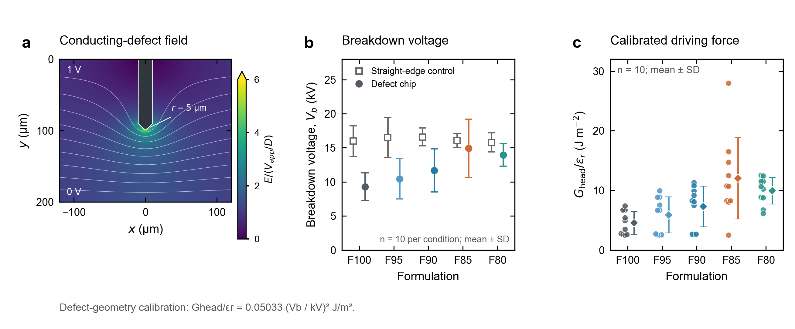

# Electrical Failure and Defect Tolerance

My doctoral research with Professor Zhigang Suo and collaborators connects a theoretical question about channel growth with the practical challenge of making controlled defects. Three related studies address the driving force for growth, its experimental measurement, and the effects of material design.

## What drives a conducting channel to grow?

Electrical failure often starts near defects, where the electric field concentrates. Predicting the growth of a conducting channel requires a connection between that local field, the energy of the system and the response of the material.

I approached this as a defect-tolerance problem, drawing on fracture mechanics to ask which quantities can be calculated, measured and compared across specimen geometries.

> A useful theory must tell us what to measure, and a useful experiment must distinguish between possible explanations.

## An energetic description

I derived an electrical analogue of the J-integral and investigated how channel geometry and mechanical deformation affect the calculated driving force. Numerical comparisons between energy changes and contour integrals provide checks on the formulation. I also implemented phase-field models in COMSOL to explore breakdown-path evolution.

<figure>
  
  <figcaption>Geometry and growth prescription from the current theoretical manuscript. The definition of channel advance is part of the model. The deformable case follows a selected equilibrium branch; stability requires separate assessment.</figcaption>
</figure>

A central question is whether an increasingly sharp tip necessarily implies a larger overall growth-driving force. Another is when mechanical deformation materially changes the electrical calculation. These questions require specifying both the system's energy and the manner in which the conducting head advances.

The current analysis uses idealised conducting channels and specified dielectric constitutive assumptions. Comparisons depend on geometry, loading and the prescribed manner of advance. A calculated driving force does not by itself establish a geometry-independent material resistance to growth.

## Making the question experimentally accessible

My first attempt used fine needles inserted manually into thin specimens. I led a small undergraduate team, but the approach did not provide the geometric precision needed for reliable measurements.

I returned to the problem after examining what earlier fabrication methods could and could not establish. I contacted manufacturers and developed collaborations involving femtosecond laser processing, electrical engineering and atomic layer deposition. The aim was to make controlled specimens in batches so that variability could be studied systematically.

Improving fabrication was part of the scientific problem: without control over geometry and preparation, a comparison between specimens could not cleanly test the model.

Current work asks how a resistance inferred from one condition performs when tested against other geometries and loading conditions. Cross-condition consistency remains a question to examine.

## Can material design change defect tolerance?

A related study compares materials under conventional breakdown tests and tests containing a deliberately introduced conducting defect. These configurations ask different questions about performance.

<figure>
  
  <figcaption>Field simulation and measured breakdown voltages for conducting-tip and straight-edge chips in the Fvc–AS material series, followed by a permittivity-normalized energy mapping for the specified geometry. F100–F80 label the material formulations. The energy mapping uses the same voltage measurements; it is not an independent test of the proposed mechanism.</figcaption>
</figure>

Under these test conditions, the formulation-dependent change in breakdown voltage was larger for tip-containing chips than for straight-edge controls. This motivates closer examination of how microstructure changes the response to an artificial defect. Establishing the mechanism requires further controls connecting structural observations, electrical properties and breakdown behaviour.

## Three connected studies

| Study | Main question | Current stage |
| --- | --- | --- |
| Theoretical driving forces | How should the electrical driving force for conducting-channel growth be defined in rigid and deformable dielectrics? | Full discussion draft with theoretical and numerical analysis |
| Controlled-defect measurement | How consistently can an inferred resistance predict measurements across geometries and conditions? | Ongoing experimental validation |
| Materials and microstructure | How does material design change the response to an artificial conducting defect? | Working manuscript with further checks in progress |

## My contribution

- Developing the theoretical formulation and numerical models.
- Turning model requirements into specimen geometries and measurement choices.
- Leading early fabrication trials and revising the approach when they failed.
- Building collaborations around fabrication and characterisation capabilities.
- Interpreting results in light of assumptions, variability and remaining tests.

Specialist collaborators contribute fabrication and characterisation expertise. The research depends on making the interfaces between theory, specimen preparation and measurement explicit.

## The approach I want to bring to neuroscience

This project has taught me to move between models, controlled changes and measurable consequences. I want to develop that approach for understanding the brain: observing how neural systems change with experience, testing candidate explanations, and using neural and behavioural evidence to refine models of learning and cognition. I am also interested in testing whether the resulting computational principles can help artificial systems learn and adapt more effectively.

[Read about my research interests](../../interests.html).
