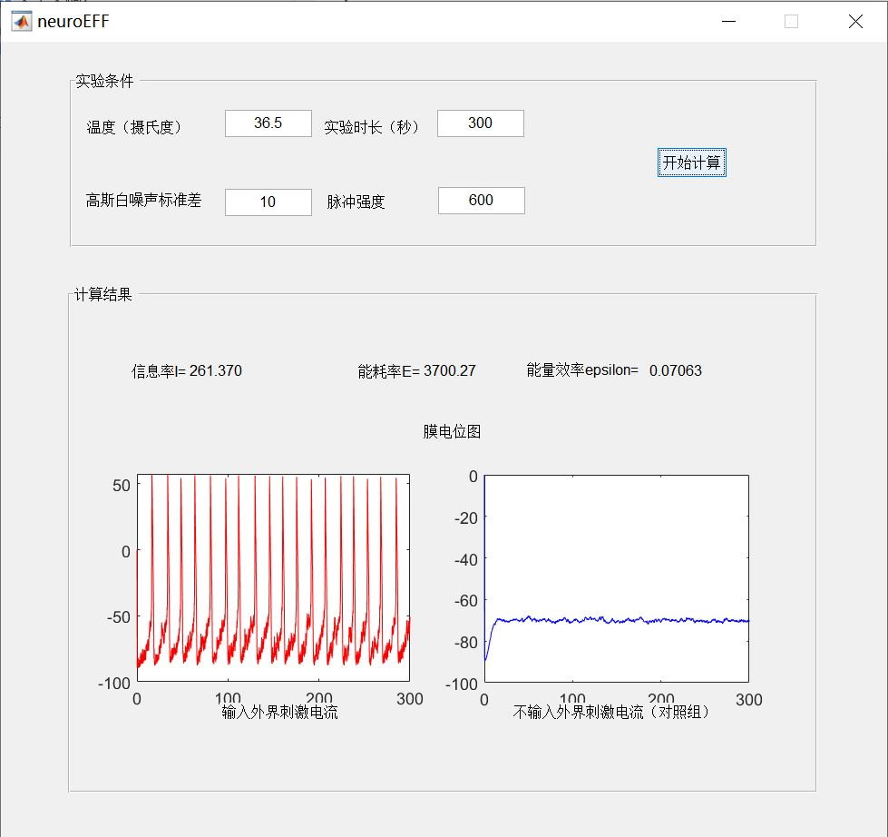

# neuroEFF — Neuronal Information and Energy Measures

During my undergraduate studies, I developed **neuroEFF**, a MATLAB tool for exploring information and energy measures in a conductance-based cortical neuron model. I led the project under the supervision of Professor Ying Wu at Xi'an Jiaotong University.

## The question

Neural signalling has both informational and energetic aspects. I was interested in how changing the conditions of a neuron model changes the relationship between its responses and its estimated energy use.

The project examined temperature, noise and stimulus intensity. Temperature was a particular focus of the conference study: how do temperature-dependent changes in a model's action potentials affect its estimated energy efficiency?

## Building a tool for comparison

I implemented the simulations and analysis in MATLAB and developed a graphical interface for exploring the model. This made it possible to work through a set of controlled changes and compare the resulting activity and calculated measures within a consistent computational setting.

<figure>
  
  <figcaption>The archived neuroEFF MATLAB interface. The displayed information and energy quantities are estimates within the chosen neuron model.</figcaption>
</figure>

## My contribution and what I learned

My main contributions were the software implementation, model simulations and analysis. The work built on an existing conductance-based model; the project used that model to ask comparative questions about neural signalling.

This was an early experience of connecting a biological question with an explicit mathematical description. It also taught me that a numerical estimate must be interpreted through the assumptions that produce it. The calculated energy measures describe the model and its accounting choices; they are not direct measurements of a neuron's metabolism.

The project continues to inform my interest in the energetic and biophysical constraints on neural computation.

## Related publication

Luo, Z., Li, L., Liang, D., Du, M., & Wu, Y. (2021). *Energy efficiency of cortical action potential at different temperatures*. CHAOS 2020, Springer Proceedings in Complexity. Springer, Cham.
