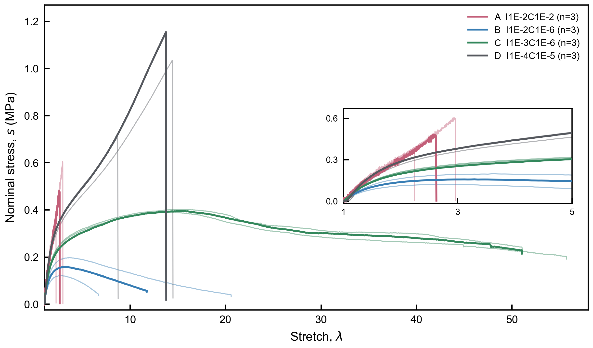

# Polymer Networks and Mechanical Response

My doctoral research investigates how changes in a polymer network's composition and preparation affect its macroscopic response. I combine synthesis and mechanical testing with simplified numerical models, using each to examine a different part of the connection between preparation, structure and behaviour.

## Composition and deformation regimes

Systematically varying initiator and cross-linker concentrations in a model polyethyl acrylate network produces distinct tensile responses. This provides an experimental setting for asking how preparation choices move a material between different deformation regimes.

The comparison depends on the shape of the full response curve as well as summary measures. I use experiments and simplified simulations to examine complementary aspects of the observed behaviour and to test candidate explanations.

<figure>
  
  <figcaption>Representative tensile-response curves for four formulations, with three records per formulation, from the current composition study. The endpoints of the records do not all indicate fracture.</figcaption>
</figure>

## Solvent history

Two materials with similar final ingredients need not have followed the same preparation path. A second study asks how changing the preparation sequence affects the eventual mechanical response.

For some formulations, the altered history produces substantial softening while retaining a similar scale of peak load-bearing response. Computational interventions help examine which proposed explanations are sufficient to reproduce aspects of this behaviour. Distinguishing the effects of preparation history requires keeping the measurement and comparison conditions explicit.

## Loading rate and large deformation

A third study examines rate-dependent tensile response in highly extensible formulations, including responses with extended stress plateaus. I am interested in how loading conditions change the behaviour observed in a material and what those changes imply for design.

The current evidence concerns tensile measurements and modelling. Establishing performance in an impact application will require tests appropriate to that application.

## My contribution

I lead the experimental and computational work connecting formulation and preparation choices to mechanical response. My work includes preparing and testing samples, comparing response regimes, implementing numerical models and interpreting results with my advisers and collaborators.

Across these studies, I have learned to separate a reproducible observation from an explanation of why it occurs. A model can help make an explanation precise, while a controlled change in preparation or loading can reveal where that explanation succeeds or needs revision.

## Research outputs

The work is being developed in three manuscripts on composition-dependent response, solvent history and loading-rate effects. Their stages differ: the composition study has a full manuscript draft, while the solvent-history and rate-dependent studies remain in development.
